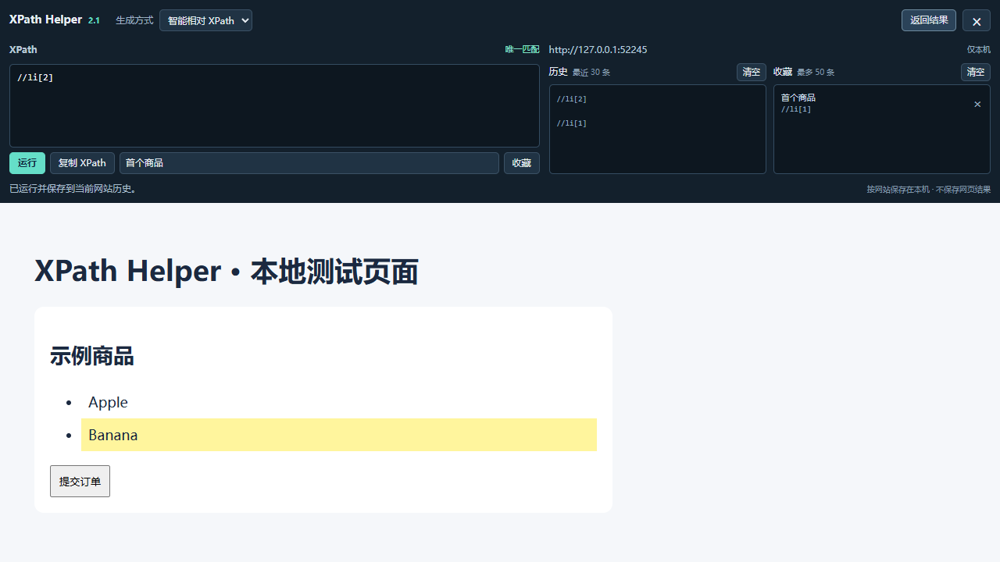

# XPath Helper (MV3)

基于 **XPath Helper 2.0.2** 的非官方 Chrome Manifest V3 适配版，采用 **Apache-2.0** 许可证。

Unofficial Manifest V3 adaptation of XPath Helper 2.0.2, licensed under Apache-2.0.

用于在网页中生成、编辑和执行 XPath，查看匹配结果并高亮元素。本项目独立维护，不是 Google、原作者或 Chrome 网上应用店的官方更新。

**v2.1.0** 新增智能相对 XPath、一键复制、按网站保存的本地历史与收藏，并修复引号和 SVG 定位问题。Windows 和 macOS 的桌面 Chrome 使用同一个安装包；macOS 尚未做实机验证。



## 安装

1. 从 [Releases](https://github.com/123wss-q/xpath-helper-mv3/releases) 下载 `XPath-Helper-MV3-v2.1.0.zip`，解压到准备长期保留的位置。也可以点击本仓库的 **Code → Download ZIP** 下载源码并解压。
2. 打开 `chrome://extensions`，开启右上角的“开发者模式”。
3. 点击“加载已解压的扩展程序”，选择**直接包含 `manifest.json` 的目录**。
4. 刷新准备使用的网页，点击扩展图标或按 `Ctrl+Shift+X` 打开面板。

安装后请保留该目录；移动或删除运行文件会影响扩展使用。更新时，将新版文件覆盖到原来的加载目录，在扩展管理页点击“重新加载”，再刷新网页。卸载扩展会清除它的本地记录；将其作为另一个扩展重新安装也不会自动迁移收藏。如安装了原版，建议关闭原版，避免快捷键冲突。

本发布提供 ZIP 供解压加载。自行打包的 CRX 可能因来源验证被 Chrome 禁用。参考 [Chrome 官方本地加载说明](https://developer.chrome.com/docs/extensions/get-started/tutorial/hello-world#load-unpacked)。

## 使用

| 操作 | 功能 |
| --- | --- |
| `Ctrl+Shift+X`，macOS 为 `Command+Shift+X` | 打开或关闭面板 |
| 打开面板后按住 `Shift`，移动鼠标到网页元素上 | 生成 XPath 并显示结果 |
| 切换“智能相对 XPath / 绝对 XPath” | 为当前选中元素重新生成路径；不改变手写 XPath 的语法 |
| 在 XPath 输入框中输入 | 自动查询，显示唯一匹配、多项、未匹配或错误状态 |
| 点击“运行”或按 `Ctrl/Command+Enter` | 运行并记入当前网站历史 |
| 点击“复制 XPath / 复制结果” | 复制对应内容；成功复制 XPath 会记入历史 |
| 输入可选名称后点击“收藏” | 保存当前表达式；相同表达式再次收藏会更新名称 |
| 点击“历史与收藏”中的条目 | 恢复并执行保存的表达式 |
| 点击收藏旁的 × 或两次点击“清空” | 删除单条收藏，或清空当前网站对应的记录 |
| 按住 `Shift`，将鼠标移动到面板标题上 | 将面板切换到页面顶部或底部 |

智能模式会验证候选路径在**当前页面**是否唯一指向目标，优先使用合适的 ID、测试属性、名称或简短文字，必要时退回祖先或结构路径。这是当前 DOM 的验证，不保证网页今后改版时仍然有效。选中图片时，沿用原版返回图片 `src` 属性的行为。

## 相对原版的改动

- 将 Manifest V2 后台页面迁移为 Manifest V3 service worker，使用 `chrome.action`。
- 更新网页可访问资源声明，去除原商店更新地址。
- 增加面板就绪握手，修复初始化时序和空查询状态。
- 按所在标签页隔离结果消息，避免不同标签页相互覆盖。
- 使用 `input` 事件响应输入和粘贴。
- 换用本项目绘制的几何图标；没有沿用原图标或打包字体。
- 增加安全的 XPath 1.0 字符串处理、SVG 命名空间定位和经验证的相对路径候选。
- 增加中文操作面板、一键复制、结果类型提示，以及本地历史与收藏。

## 页面访问与数据

内容脚本使用 `<all_urls>` 匹配规则，在浏览器允许访问的页面读取 DOM、计算 XPath，并添加面板和高亮。使用时可以查看和调整 Chrome 扩展详情页中的网站访问设置。

当前实现不包含账号登录、遥测、广告、远程代码加载或将查询及网页内容上传服务器的逻辑。

v2.1 新增 `storage` 权限，使用 `chrome.storage.local` 保存表达式和收藏名称。只有主动运行、成功复制 XPath 或点击收藏时才写入；鼠标悬停和输入过程不会自动记录，匹配结果不保存。**表达式本身可能包含页面文字或属性值**，请按需删除。

- 按网站来源（协议、域名、端口）区分，同一来源的不同路径共用记录；所有本地文件共用 `file://` 分类。
- 每个网站最多保留最近 30 条历史和 50 条收藏，相同表达式去重。
- 总计最多 100 个网站、约 2 MiB；空间紧张时会回收较旧历史，收藏不会被自动删除，无法继续保存时显示错误。
- 不使用云同步；隐身窗口可以查询和复制，但不读取或保存历史收藏。
- 复制仅在点击对应按钮时写入剪贴板，不读取剪贴板；失败时提供手动复制提示。

## 已知限制

- Chrome 内置页面、Chrome 网上应用店等受保护页面无法使用。
- 安装或重新加载后，已经打开的网页需要刷新。
- 只检查顶层页面，不检查嵌套 iframe 或 Shadow DOM 内部元素。
- 检查本地 HTML 文件，需要在扩展详情中开启“允许访问文件网址”。
- 使用浏览器内置 XPath 1.0。动态属性、页面改版、复杂文档仍可能需要手动调整表达式；生成器对候选数量和嵌套深度设有限制。
- 受组织管理的浏览器可能限制开发者模式或本地扩展加载。

## 验证与开发

无构建步骤，也没有需要安装的运行依赖。可用 Node.js 执行检查：

```sh
node --check background.js
node --check bar.js
node --check content.js
node --check xpath.js
node --check library.js
node tests/routing.cjs
node tests/library.cjs
node tests/xpath.cjs
node tests/panel.cjs
```

单元检查覆盖内容脚本协议、后台发送者校验、站点隔离、存储并发与容量、面板异步状态以及 XPath 字符串转义。`tests/fixtures/xpath.html` 提供实际 DOM 定位案例。

v2.1.0 发布前检查：38 项协议/存储/面板检查、1,572 个字符串转义案例通过；在 Windows 的 Chromium 151.0.7922.34 中，25 项端到端操作和 32 个实际 DOM 定位案例通过，控制台无错误。

浏览器集成测试使用 **测试版 Chromium**、临时用户配置和本地测试页面。先在开发环境安装 `playwright-core`，再运行：

```sh
node tests/browser.cjs --browser /path/to/test-chromium --artifacts work/browser-tests
```

也可设置 `PLAYWRIGHT_MODULE_PATH` 指向已安装的测试依赖位置。测试覆盖真实 DOM 定位、面板操作、复制接口、跨标签页和跨网站隔离、收藏持久化及窄窗口布局；剪贴板测试使用隔离的接口替身，不改动系统剪贴板。这些检查不代表所有网站或操作系统都已验证。正式版 Chrome 的自动化侧载限制见 [Playwright 官方说明](https://playwright.dev/docs/chrome-extensions)。

## 来源与许可证

本项目以 **XPath Helper 2.0.2** 扩展包为修改基础，原项目源码位于 [google/xpaf 的 chrome 目录](https://github.com/google/xpaf/tree/master/chrome)。原包 `package.json` 声明 `Apache-2.0`，JavaScript 和 CSS 中保留以下原始版权声明：

```text
Copyright 2011 Google Inc. All Rights Reserved.
```

感谢原作者及贡献者；上游 [AUTHORS](https://github.com/google/xpaf/blob/036b52956bc4d52dcff404478ba73fa6a2d0fe47/AUTHORS) 和 [CONTRIBUTORS](https://github.com/google/xpaf/blob/036b52956bc4d52dcff404478ba73fa6a2d0fe47/CONTRIBUTORS) 分别列出 `opensource@google.com` 和 Adam Sadovsky。

来源核对参照上游提交 [`036b529`](https://github.com/google/xpaf/tree/036b52956bc4d52dcff404478ba73fa6a2d0fe47/chrome)：原扩展包的 HTML/CSS 等文件与该提交对应，JavaScript 另含严格模式声明，清单另含商店更新地址；本项目不声称原扩展包与整个上游目录逐字相同。

原作者及贡献者的声明保留在源文件中，修改过的 JavaScript 文件附有修改说明，清单中的描述注明非官方 MV3 适配身份。完整许可证见 [LICENSE.txt](LICENSE.txt)，来源及修改记录见 [NOTICE.txt](NOTICE.txt) 和 [CHANGELOG.md](CHANGELOG.md)。

本项目新增的说明、测试及几何图标也按 Apache-2.0 提供。许可证不代表原作者或 Google 对本改版的认可或背书。
